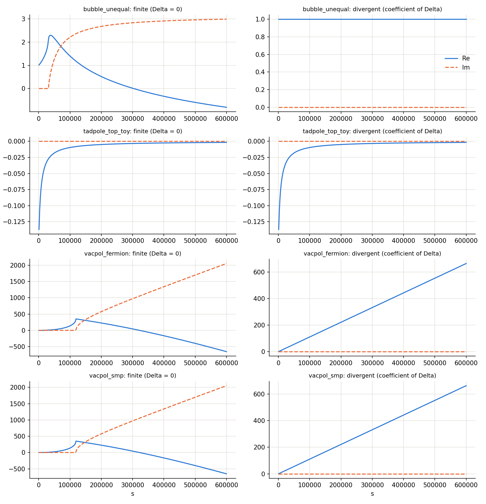

# ampflow

FeynCalc amplitudes → C++ → scanned numbers (SLHA card in, CSV out) → plots. CMake builds everything.

```
amplitudes/*.m ─┐                                      cards/*.slha ─┐
                ├─ fc2lt: lex → parse → RESOLVE → emit  scans/*.scan ─┤
models/*.model ─┘        (one parser, one pass)                        ▼
                                │  generated/amp_*.h             ampscan ──▶ data/…/*.csv ──▶ plots/…/*.png
                                └──────────────────────────────────▲
```



## Quick start

```bash
cmake --preset default                 # LoopTools (A0, B0, C0, D0); fetched and built into third_party/ on the first run if not installed
cmake --build build/default
cmake --build build/default --target scan     # every scan of every workspace -> build/default/data/<workspace>/<run>/*.csv
cmake --build build/default --target plots    # -> build/default/plots/...      (needs python3 + numpy + matplotlib)
build/default/examples/sm/ampscan --list      # the compiled-in amplitudes: inputs and SLHA entries each one needs
```
Without presets: `cmake -S . -B build [-DLOOPTOOLS_ROOT=/prefix]`.

**LoopTools.** If LoopTools is not found (`-DLOOPTOOLS_ROOT`, `$LOOPTOOLS_ROOT`, system paths), the first `cmake` run downloads
version 2.16 from https://feynarts.de/looptools/ (MD5-checked), builds it and installs it into `third_party/looptools/` inside the repository; later runs reuse it.
It needs `gfortran`, a C compiler, `make` and network access, and takes a few minutes. **No network?** Download `LoopTools-2.16.tar.gz` by hand from
https://feynarts.de/looptools/ , put it into `third_party/looptools/`, and configure again: it is unpacked and built from there. Options:
`-DAMPFLOW_LOOPTOOLS_VERSION=2.15`, `-DAMPFLOW_LOOPTOOLS_URL=...`, `-DAMPFLOW_LOOPTOOLS_MD5=...`, `-DAMPFLOW_LOOPTOOLS_DIR=...`, `-DAMPFLOW_FETCH_LOOPTOOLS=OFF`.

## The idea: a workspace

A **workspace** is a folder that holds one project's physics and numbers; the tools (`src/`) stay untouched.

```
examples/sm/                 <- a workspace
├── CMakeLists.txt           ampflow_add_workspace(sm)  + its tests
├── amplitudes/*.m           FeynCalc exports; the file name is the amplitude name
├── models/*.model           what the symbols mean (applied after the library models, in file-name order)
├── cards/*.slha             parameter cards (read at run time)
└── scans/*.scan             what to scan (read at run time)
```

| What | Where | Read | After a change |
|---|---|---|---|
| Physics | `amplitudes/NAME.m` | at translation | rebuild |
| Meaning of the symbols | `models/*.model` | at translation | rebuild (automatic) |
| Numbers | `cards/*.slha` | at run time | nothing to rebuild |
| Run | `scans/*.scan` | at run time | nothing to rebuild |

Symbols are bound **once, when the code is generated**: no second parser, no string matching at run time. Your own project is
another workspace: `-DAMPFLOW_EXTRA_WORKSPACES=/path/to/mywork` (see [docs/workspaces.md](docs/workspaces.md)).

## Repository layout

```
CMakeLists.txt, CMakePresets.json, cmake/     build logic in small modules (options, LoopTools, python, workspace)
src/fc2lt/                 the translator: lexer → parser → model/resolve → dimension → emitter → render   (header-only core + CLI)
src/ampscan/               the runner: SLHA reader, scan files, evaluation, CSV writer, command line
include/ampflow/           Amplitude / Args: the interface between generated code and the runner
models/                    library models every workspace starts from (Standard Model, FeynCalc SMP, FeynArts FCGV)
templates/                 SLHA card templates: standard blocks, a custom block, and the same for the 2HDM
examples/sm, examples/thdm example workspaces (Standard Model A0..D0 amplitudes; two-Higgs-doublet model)
python/ampflow/            reading and plotting the CSV repository
mathematica/               FeynArts + FeynCalc scripts: diagrams → form factor → export
docs/                      the documentation below
```

## Documentation

| | |
|---|---|
| [docs/architecture.md](docs/architecture.md) | the pipeline stage by stage, and how the CMake modules map onto it |
| [docs/workspaces.md](docs/workspaces.md) | adding your own workspace, amplitudes, scans; the CMake functions; exporting from Mathematica |
| [docs/models.md](docs/models.md) | the model language, the standard and custom card templates |
| [docs/fc2lt.md](docs/fc2lt.md) | the translator: FeynCalc compatibility (SMP, FCGV, Unicode), the D → 4 limit, the command line |
| [docs/output.md](docs/output.md) | the CSV format, finite and divergent parts, backends |
| [docs/thdm.md](docs/thdm.md), [docs/loops.md](docs/loops.md) | the 2HDM workspace; the C0/D0 amplitudes and how they are checked |
| [docs/status.md](docs/status.md) | what is assumed and **what was not verified** |
| [mathematica/README.md](mathematica/README.md) | the FeynArts + FeynCalc scripts |

## Status

This tree has no tests. During development it was built with LoopTools 2.16 (Ubuntu package). The Mathematica scripts have **not** been run
(Mathematica, FeynArts and FeynCalc were not available). The assumptions and what was not verified: [docs/status.md](docs/status.md).
