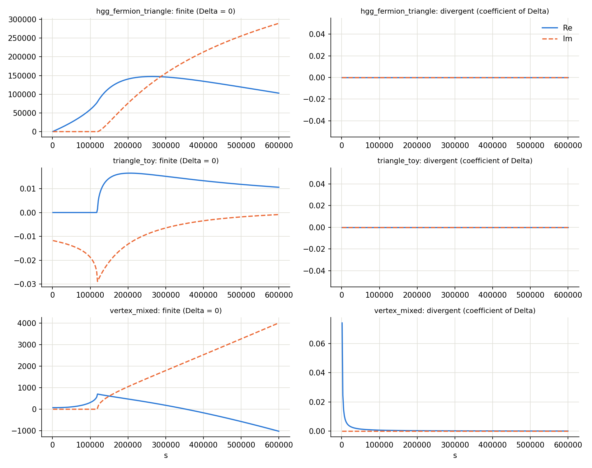

# C0 and D0 amplitudes

Seven amplitudes in `examples/sm/amplitudes/` use `C0`/`D0`. `scans/thresholds.scan` and `scans/euclid.scan` run them. During development each was compared with references that use neither LoopTools nor the generated code
(closed forms, and the Feynman-parameter integral done by quadrature); that test code is not part of this tree.

| Amplitude | Content | Kinematics | Compare with |
|---|---|---|---|
| `hgg_fermion_triangle` | h→γγ fermion loop, `mf² (2 + (4mf² − s) C0)` | s > 0, across 4 mf² | closed form of C0(0,0,s), real **and** imaginary part |
| `triangle_toy` | `C0` with a complex prefactor `I α Nc mt²` | s > 0 | same |
| `vertex_mixed` | `C0` + `B0(s) − B0(0)` + `A0/s`: one pole survives | s > 0 | closed forms; divergent part `α/π · mf²/s` |
| `triangle_euclid` | `C0`, masses t, b, W, two off-shell legs | all invariants < 0 | 2-D quadrature |
| `box_massless_legs` | `D0`, four massless legs, equal masses | s, t < 0 | 3-D quadrature |
| `box_offshell_unequal` | `D0`, four off-shell legs, masses t, h, W, Z | all < 0 | 3-D quadrature |
| `lbl_like_mix` | `A0 + B0 + C0 + D0` with SMP atoms and `\[Alpha]` | s, t < 0 | quadrature + closed forms; divergent part `α²(s+t)/(st) mt²` |

Agreement with LoopTools 2.16 was about 1e-13; swapping `s` and `t` in the `D0`, or two legs in the `C0`, was detected by those comparisons.
