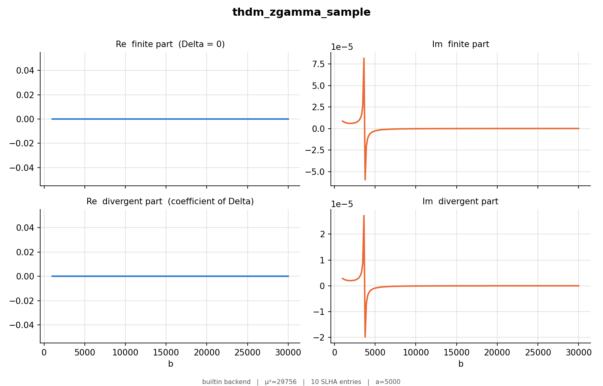

# The two-Higgs-doublet model workspace (`examples/thdm`)

CP-conserving 2HDM, softly broken Z₂, in the notation of the FeynArts THDM model.

| Piece | File |
|---|---|
| Standard blocks: `SMINPUTS`, `MASS` 24/25/35/36/37 (W, h0, H0, A0, H+), `MINPAR` 3 (tan β), `ALPHA` | `templates/thdm_standard.slha` |
| Custom block `THDM`: 1 = λ₅ | `templates/thdm_custom.slha` |
| Both joined; a bounded-from-below, perturbative benchmark (tan β = 2, cos(β−α) = 0.05, m_H = m_A = m_H± = 500, M = 480) | `examples/thdm/cards/thdm.slha` |
| Symbols: the `ConventionNotation` list (EL, cosW, CAB, S2B, Mh0, MHp, Lambda5, ...), `Subscript[m, W]`, `Subscript[θ, W]`, `x = m_h²`, `y = m_Z²`, `Δ`, the couplings | `examples/thdm/models/thdm.model` |
| The sample amplitude and a scan (`b = k2·k3`, `a` fixed, `c` from momentum conservation) | `examples/thdm/amplitudes/`, `scans/thdm.scan` |

`alpha` is the h–H mixing angle here (the Standard Model library model keeps α_em as `alphaEM`); `Delta` is the Gram determinant `a²y − 2abc + b²x`.

## Couplings

`g_hhH0` and `g_h0H0H0` are `∂³V/∂h²∂H` and `∂³V/∂h∂H²` (vertex `−i g`), derived from the potential with `M² = m12²/(sβcβ) = m_A² + λ₅v²`:

```
g_hhH = cos(β−α)/(v sin2β)  [ (2m_h²+m_H²−3M²) sin2α + M² sin2β ]
g_hHH = −sin(β−α)/(v sin2β) [ (m_h²+2m_H²−3M²) sin2α − M² sin2β ]
```
They agree with the third derivatives of the potential to 1e-15 at random parameter points. λ₁…λ₄ follow from the masses, α, β and M².
`v = 2 m_W sin θ_W / e` is one line in the model (change it for v from G_F).

## Kinematics of the sample

Read off the propagators: H0(k1+k2+k3) → h0(k1) Z(k2) γ(k3) through an intermediate h0\* or H0\* → Zγ top loop; `x = m_h²`, `y = m_Z²`, `k3² = 0`, so
`2a + 2b + 2c = m_H² − x − y` and `c` follows. With `a = 5000` the physical (Dalitz) region is 193 < b < 41850; Δ vanishes at its edges and the amplitude has a `1/Δ` there.
The scan stays inside and crosses the on-shell pole of the h0 propagator at `b = (x−y)/2 = 3686` (no width in the amplitude).

## Cross-checking

During development the pipeline output was compared with an independent evaluation — couplings differentiated out of the potential, the D → 4 term worked out by hand (`−2m(B0+3)`) —
and agreed to about 7e-12 relative; seven deliberate model errors (a wrong angle, a sign, a factor 2 in the vev, the momentum relation, a typo in Δ, the sign of α) were all detected.
That test code is not part of this tree.


